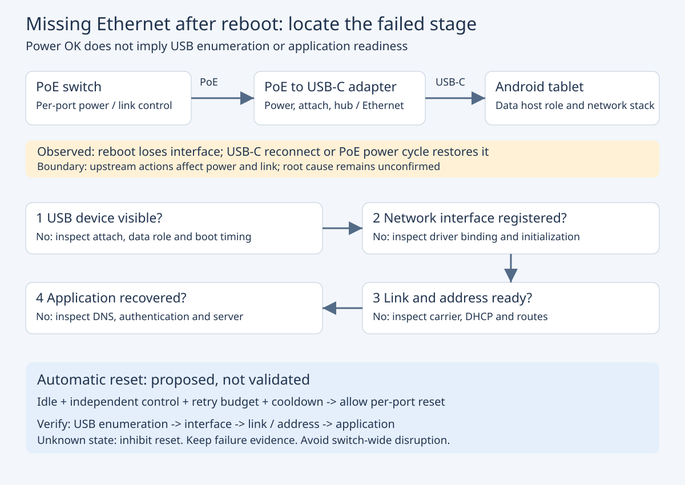

一台运行 Android 11 的工业平板，通过 PoE 转换器和单根 USB-C 线同时获得电源与有线网络。平时联网正常，但保持线缆连接重启平板后，系统中没有 `eth0`；开机完成后拔插 USB-C，网卡又会出现。继续做对照发现，不拔 USB-C，只断开再恢复 PoE，网卡也会出现；重启 PoE 交换机同样能恢复网络。

这组现象把排查方向从“网络参数不对”推进到了“启动过程中，USB 网卡如何被系统发现”。本文保留这一技术关系，将设备部署环境泛化。人工重新上电恢复已经观察到，自动延迟上电与自动端口复位尚未完成验证，不能据此宣称问题已经彻底解决。



## 一、先区分网卡不存在与网卡没有地址

“没有网络”至少包含三类完全不同的状态：系统没有注册对应网络接口；接口存在但链路未建立；链路存在但地址、路由或业务连接失败。只有先确定落在哪一层，复位才有明确对象。

| 观察 | 优先检查 | 此时不应直接得出的结论 |
| --- | --- | --- |
| 全部接口中找不到目标有线接口 | USB 枚举、数据角色、驱动绑定及初始化日志 | DHCP 服务器坏了 |
| 接口存在但无 carrier | 网线、PHY、交换机端口、协商状态 | App 没有网络权限 |
| 链路建立但无可用地址或路由 | DHCP、静态配置、路由策略 | USB 网卡必须断电 |
| 地址路由正常但业务失败 | DNS、服务端、应用连接与认证 | 重启整个交换机可以修复根因 |

接口名称不一定固定为 `eth0`。这里的关键是遍历全部接口后确认目标接口缺失，而不是只搜索一个名字。USB 设备列表中可见适配器，也不等于内核已经成功注册网卡；两份证据需要对照。

恢复以太网默认配置的尝试没有解决需要拔插的问题。这与“接口尚未创建”的判断相符：修改地址配置不会替代 USB 设备枚举，也不能强迫失败的驱动初始化重新完成。

## 二、单线供电联网为什么会出现启动时序差异

整条链路可以拆为 PoE 受电与稳压、USB-C 连接及角色建立、USB 设备枚举、网卡驱动初始化、以太网链路与地址配置、业务连接。电源和数据不是同一个状态：平板能充电，只能说明某条供电路径成立，不能证明主机数据角色、Hub 和网卡都已准备好。

在这种组合中，平板可能承担 USB 数据主机角色，同时从转换器获得电力；实际能力由平板、转换器、线缆及协商实现共同决定。不能把“USB 主机”简单等同于“必然由平板给整个转换器供电”，也不能把充电图标作为枚举成功证据。

重启平板与重新插入转换器触发的事件并不相同。平板重启时，转换器可能一直处于通电状态；物理重新连接则可能改变连接检测、数据角色、集线器状态和网卡初始化顺序。因此，“热插拔成功、带线重启失败”支持启动时序或复位链路存在兼容问题，但仍不能唯一确定是哪颗芯片或哪段固件出错。

转换器使用 RTL8152 系列网卡，Linux 的 `r8152` 驱动早已有相应实现。但上游内核包含驱动，不代表某台 Android 设备的厂商内核一定启用了相同配置或修复。反过来，热插拔之后确实能联网，说明当前系统在某些条件下能够驱动这套设备，不能笼统认定“Android 完全不支持这颗网卡”。

## 三、三种恢复动作分别证明了什么

物理拔插 USB-C 同时影响多种条件，适合作为恢复对照，不适合单独定位根因。PoE 断开再恢复的实验更进一步：不动平板侧插头也能恢复，说明这套组合至少存在一个上游供电或连接状态变化，可以促成网卡重新可用。

不过，PoE 动作同时可能影响转换器电源与以太网链路。没有电压波形、USB 事件和驱动日志，就不能认定是“网卡断电十秒修复了驱动”，也不能将它解释成单纯的 DHCP 重连。内部电容、隔离电源、供电回灌与 Hub 拓扑都会影响实际复位范围。

重启交换机的结果与上述观察相互支持，但它的作用范围更大。若一个单端口动作足以恢复，整机重启会额外打断其他终端，作为长期措施并不合适。下一步应在允许停机的条件下比较：仅关闭目标端口的 PoE 电源、仅切换数据链路、物理重新连接。注意有些交换机的“禁用端口”只关闭数据，PoE 仍持续供电，不能混作同一实验。

## 四、采集可比较的证据，而不是先写自动重试

以下命令用于已安装 ADB、已获得设备调试授权的维护终端，只读取状态。示例不要求 root；厂商系统可能限制 `dumpsys` 或日志内容，遇到拒绝应记录为“不可观测”，不能当作设备列表为空。不要把完整输出直接公开，其中可能包含地址、标识及业务信息。

```bash
adb shell ip link show
adb shell ip addr show
adb shell ip route show
adb shell dumpsys usb
adb shell dumpsys ethernet
adb shell dumpsys connectivity
adb logcat -d -v threadtime
```

分别在带线重启失败后、人工恢复后采集同一组状态。对比时关注目标 USB 设备是否存在、数据角色是否变化、驱动是否注册网卡、链路是否建立，以及网络服务最终选用了哪条路由。`dumpsys` 不是稳定的机器接口，自动程序不能只靠固定字符串位置解析不同厂商版本。

若 USB 设备缺失，先研究连接和枚举；设备存在但网卡缺失，继续看绑定、初始化失败与厂商驱动；网卡存在而地址失败，再查网络层。日志中没有错误也不是初始化成功的证明，可能只是日志缓冲已覆盖或权限不足。

Android 的 USB Host API 可以枚举设备，应用获得设备访问权限后可以进行相应通信。这与重置整个 Type-C 端口是两种能力。不能把申请 USB 访问权限、拥有设备管理身份或授予日志诊断权限，直接等同于具有物理端口断电与角色切换能力。尤其不能把新版 Android 的系统级 USB Port Reset API 当作 Android 11 普通 APK 随时可调用的接口。

## 五、先选可控的恢复对象，再设计自动化

针对当前证据，可比较以下路径。它们的评价依据应是相同硬件和固件组合下的重复测试，而不是芯片品牌。

| 路径 | 价值 | 实施条件与限制 |
| --- | --- | --- |
| 厂商固件或 USB 管理能力 | 有机会处理底层启动兼容性 | 需确认具体系统版本、权限、端口行为；配置成功不等于重枚举成功 |
| 受控切换目标端口 PoE | 接近已经有效的人工动作，故障域较小 | 需独立控制通道；确认确实关闭电源且不会使控制器失联 |
| 延迟转换器上电 | 适合“主机已就绪后连接可以成功”的假设 | 平板必须能独立启动；断电后不能被另一供电路径维持工作 |
| 更换转换器 | 可以绕开特定组合的时序问题 | 按冷启动、热启动、供电切换矩阵选型；同品牌或同芯片不能保证解决 |

PoE 是包含检测与供电管理的系统。优先使用交换机支持的目标端口电源控制，或经过明确验证的整套供电产品。这里不提供剪断网线芯线或切断 USB-C CC 引脚的接法：那会改变协议、电气和故障边界，不能从本次观察推导出安全、通用的接线方案。

## 六、自动恢复需要有停止条件

下面是控制逻辑的结构示例，不是可直接运行的设备程序。部署前需要提供：可信的设备空闲信号、目标端口身份、独立控制通道、设备允许的供电中断条件，以及经过试验确定的等待时间和动作次数预算。缺少任一条件，都保持诊断状态。

```text
开机观察窗口结束
  -> 确认目标接口持续缺失，而非只有业务不可达
  -> 确认设备空闲、维护允许、供电条件满足
  -> 检查复位次数预算和冷却期
  -> 对目标端口执行一次受控断电与恢复
  -> 等待 USB 枚举、网卡注册、链路和地址依次恢复
  -> 通过目标业务探测后结束；超时则锁定故障并保留证据
```

动作预算应跨恢复控制进程的重启保留，避免每次进程重启都重新获得无限重试机会。等待时间应由实测启动分布与转换器断电特性确定，不能把网上某个固定秒数当作电气规范。接口已经存在时，也不应仅因远端业务故障而反复断电。

对于移动设备，恢复控制还要理解现场状态：运行中打断供电或通信可能使告警、显示或控制失效，因此应在停车或明确维护窗口实施。空闲信号未知时不执行复位。恢复通道也不能依赖正在被复位的同一条链路，否则断电命令发出后可能无法再发送上电命令。

## 七、怎样判断可以从人工措施转为工程方案

验证矩阵至少覆盖平板带线重启、平板冷启动、转换器持续通电、转换器先上电、转换器后上电、单端口电源切换，以及恢复过程中再次发生故障。每种状态都记录重复次数、网卡出现时间、地址完成时间和业务恢复结果；样本量与允许失败率应在试验前约定。

特别检查平板电量偏低、外部供电中断、自动关机策略与转换器重新上电之间的耦合。平板依赖外部电源才能启动时，“延迟转换器上电”可能让主机永远无法先就绪；有电池也不代表它不会因既有电源管理逻辑关机。这种情况下必须先重构启动条件，再讨论延迟。

本次可以确认的是：故障表现为目标网络接口缺失，人工 USB-C 重连或 PoE 重上电后可恢复。合理的工程方向是围绕 USB 初始化链路继续采证，并把已有效的人工动作缩小为可控、有限次的目标端口操作。尚不能确认具体根因，也没有自动恢复长期稳定运行的证据。把这些边界保留下来，后续才有依据判断是固件修复、供电时序调整还是更换适配器真正消除了问题。

## 参考资料

- [Android USB Host：设备枚举与访问权限](https://developer.android.com/develop/connectivity/usb/host)。用于理解应用可观察的 USB 设备与权限边界。
- [Linux v5.10 的 r8152 驱动](https://github.com/torvalds/linux/blob/v5.10/drivers/net/usb/r8152.c)。固定版本源码用于核对该系列网卡的既有驱动实现，不能代替目标厂商内核验证。
- [AOSP USB Port Reset API](https://source.android.com/docs/automotive/usb-reset)。文档说明其系统特权与 Android 13、USB HAL v2.0 等条件，不能倒推为 Android 11 普通应用能力。
