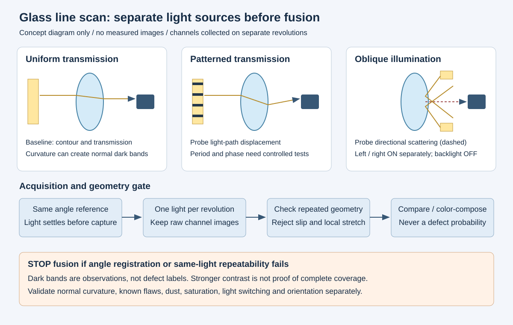

透明玻璃瓶的缺陷检测，常常先卡在“能不能拍出来”。气泡、结石、浅划痕和局部凹凸对光的作用不同：有的改变透射强度，有的主要改变光线方向，有的只有在某个照明方向下才明显。把所有问题交给一个模型，容易把成像盲区变成无法解释的漏检。

这次研究把目标收窄到多光源显影与叠加显示，不先讨论自动判定，也不追求真实深度。已有的对比观察是：均匀背光被局部遮住以后，瓶身出现明显明暗变化，同时产生了大面积暗区。这个现象足以说明光场变化会影响图像，却不能证明暗区就是缺陷，更不能证明遮光越多越容易检测。



## 一、半遮挡背光为什么会产生正常暗带

相机看到的不是光源平面上的一块颜色，而是穿过瓶壁后进入镜头孔径的一束光。圆柱曲面、前后两层瓶壁和壁厚变化共同改变光路。可以把某个像素的亮度理解为：镜头所接收的各条光路，分别在光源上落到什么位置，以及那里有多亮。

均匀背光下，光路在光源平面上小幅移动，亮度变化可能不大；遮掉一半以后，原来落在亮区的光路可能落入黑区。即使没有缺陷，瓶身曲率和旋转角度也能造成明显灰度变化。镜头有限孔径还会把不同光路混合，所以实际边界不会严格复制遮光板边界。

这也解释了一个常见误区：直接把照片中的暗带认定为“遮光板阴影”，再试图靠图像均衡化消掉它。部分暗带来自正常折射后的能量分布，均衡化只能重新分配灰度，不能恢复根本没进入镜头的缺陷信号。应先拿同瓶型正常件做重复采集，判断暗带是否跟随瓶身角度、光源位置或遮光边缘移动。

条纹周期变小也不必然有效。条纹过密时，光学离焦、孔径积分和玻璃多条光路可能降低对比度；过疏时，可用梯度覆盖不足，许多位置仍只落在一整块亮区或暗区。合适周期是整个成像系统的属性，不能只按遮光板尺寸确定。

## 二、把照明分成承担不同任务的通道

| 通道 | 研究目标 | 常见混淆 | 应保留的对照 |
| --- | --- | --- | --- |
| 均匀透射背光 | 建立轮廓、透射基线和遮挡特征 | 厚壁、瓶肩、模具纹理也会发暗 | 同瓶型正常件的重复旋转图 |
| 条纹透射 | 把偏折差异转成明暗变化 | 正常曲率也使条纹变形，周期纹理会干扰匹配 | 固定周期下不同条纹位置的原图 |
| 左右斜入射 | 寻找表面散射和方向性划痕响应 | 灰尘、反射和背面结构也可能发亮 | 左右方向分开采集，保留无缺陷区域 |

暗场描述的是直接光避开镜头、散射光进入镜头的成像关系，不是“把灯放斜”这个动作。玻璃曲面会改变反射和折射方向，某段瓶身可能形成暗场，另一段却出现直接亮斑。照明方案必须按视野区域评价，不能因为中心区域看着干净就认为全瓶都有效。

原型阶段可先使用一张稳定背光图，随后关闭背光，分别采集左右斜入射；条纹透射作为另一个独立实验支路。这样能判断新增信息来自哪个通道。如果同时点亮所有光源，暗场背景可能被背光抬高，缺陷的散射对比反而下降。

这里没有采用“一种灯覆盖全部缺陷”的假设，也没有给出已经验证的最佳角度。当前证据支持继续做受控对照，不支持全缺陷检出承诺。

## 三、线扫多圈采集：先对齐角度，再讨论叠加

线扫图像的一个轴来自传感器，另一个轴来自旋转。若转速为每秒 r 圈、每圈希望采集 N 行，在匀速且无丢行的理想条件下，行频为 N×r。某一行的曝光时间还受到相机实际时序约束，并不是设置了行频就一定能用满整个行周期。

多光源低成本验证可以先分圈采集：一圈背光、一圈左侧斜光、一圈右侧斜光。每圈从同一角度基准开始，使用相同展开方向、行数和感兴趣区域；切灯后先等待亮度稳定，再接纳有效数据。等待时间应通过灯光控制器与实际图像测得，不能把串口命令返回当成光强已经稳定。

固定行频加电机标称转速，只在转速稳定时近似成立。转速波动会形成局部拉伸，起点一致也不能保证每一行对应同一角度。编码器角度触发更适合控制这一误差，但需要核对每圈脉冲数、分频、相机触发能力和机械滑移；设备具备接口不等于已经完成同步。

分圈还有一个不可绕过的条件：瓶子必须保持刚性定位，不能在夹持或换向时发生相对滑动。否则第二圈的缺陷和第一圈轮廓未必属于同一个展开坐标。第一次验证可以在正常件上设置可移除的外部标记，仅用来检查几何重复性；标记区域不要参与缺陷对比。

配准也不应盲目依赖亮度相似。条纹位置变化、暗场与背光的成像差异都会让相关性方法失效。若同照明的两次重复图都无法稳定对齐，应先处理机械和采集；若只有跨照明匹配失败，应寻找共同几何基准，而不是不断放宽匹配阈值。

## 四、一个可复现的融合显示示例

下面只做可视化，不输出缺陷类别或合格结论。运行环境为 Python 3、NumPy 和 Pillow。输入是已经完成角度对齐、尺寸一致的三张 8 位灰度 PNG，分别对应背光、左侧和右侧斜入射。文件名是本地实验约定，需要自行准备；原始相机高位深数据应另行保存，本例不负责转换、触发和配准。

```python
from pathlib import Path
import numpy as np
from PIL import Image


def read_gray(path):
    with Image.open(path) as im:
        im.load()
        if im.mode != "L":
            raise ValueError("Expected an 8-bit grayscale image")
        return np.asarray(im, dtype=np.float32) / 255.0


base = read_gray("backlight.png")
left = read_gray("oblique_left.png")
right = read_gray("oblique_right.png")
if base.shape != left.shape or base.shape != right.shape:
    raise ValueError("Align images before composing")

# Color channels identify illumination sources; they are not probabilities.
rgb = np.stack([left, base, right], axis=-1)
Image.fromarray(np.round(rgb * 255).astype(np.uint8), "RGB").save(
    Path("illumination_channels.png")
)
```

红色来自左侧斜光，绿色来自背光，蓝色来自右侧斜光。彩色边缘可能表示方向性响应，也可能表示配准错误；应回看单通道图和同照明重复图。不能仅凭合成图颜色判断缺陷类型。

示例没有逐张自动拉伸直方图，因为那会掩盖光强与曝光不一致。不同通道允许采用不同曝光以获得有效信号，但比较同一通道的多个样本时应固定设置，并检查饱和比例、暗电平和噪声。若需要平场校正，应使用对应照明的校正图，避免把均匀背光校正套到条纹图上，主动抹掉所需条纹。

直接取三张图的最大值也不适合当作通用融合方案。它可能把暗场噪点提亮，同时覆盖背光中的暗缺陷。通道合成至少保留了信息来源；原图并排显示仍是判断是否新增可见细节的必要入口。

## 五、低成本实验怎样避免得出错误结论

先保留均匀背光基线，在固定相机、瓶型和夹持条件下，用正常件验证重复性。再只改变一项：遮光位置、条纹周期、条纹偏移或斜光方向。纸质遮罩适合初筛可见性，不能代表最终结构的刚度、耐热或长期稳定性；设计可调遮光机构前，应先证明所需调节范围确实有用。

对照集应包含不同方向的划痕、气泡、夹杂、局部凹凸，以及可能混淆的正常模具纹和脏污。对每个已知位置记录在哪些通道可见、正常件是否产生类似响应、重复旋转后是否仍然可见。样本数、缺陷来源和标注可靠性需要单独保存，不能从少量显影图推导总体检出率。

| 现象 | 优先检查 | 暂时不能得出的结论 |
| --- | --- | --- |
| 暗带随遮罩移动 | 正常折射、遮罩边缘及孔径混合 | 暗带位置就是缺陷位置 |
| 同照明两圈存在局部拉伸 | 转速、触发、丢行和夹持滑动 | 全局平移配准已经足够 |
| 左光明显、右光不明显 | 方向性散射及直接反射 | 另一方向没有缺陷 |
| 合成图出现彩色重影 | 角度基准和跨通道几何误差 | 彩边就是浅划痕 |
| 调亮后细节变少 | 饱和、背景抬高和有效动态范围 | 需要更大的模型才能恢复 |

## 六、结论与下一步

当前能确认的是，局部遮挡背光改变了正常玻璃瓶的图像分布，大面积暗区不能直接作为缺陷依据。可继续验证的路线是：用均匀背光保存基线，用独立条纹透射研究偏折响应，用左右斜入射补充方向性散射，先保证每个通道的原图与角度坐标可信，再讨论融合显示。

尚未完成的部分包括缺陷类别覆盖、跨瓶型重复性、稳定同步和节拍评价。没有这些结果，不能宣称该方案已经解决零缺陷样本检测，也不能把显影改善等同于自动识别成功。只有确认某个通道在正常件上稳定、在已知缺陷上反复提供新增信息，才值得把它固化为机械结构或送入后续算法。

## 参考资料

- [Basler runner 用户手册，2013 年版](https://assets-ctf.baslerweb.com/dg51pdwahxgw/73HQcsQSKsf5EZ1P1KMQ40/34afa3476973b18ea9550dba5cbca315/Manual_runner_all_combined.pdf)：线扫时序与编码器触发背景；本文不直接套用其中设备参数。
- [Edmund Optics 线扫照明白皮书，2024 年](https://www.edmundoptics.com/ViewDocument/Linescan-Whitepaper-2024.pdf)：亮场、暗场与光路一致性的工程约束。
- [Nikon MicroscopyU：Darkfield Illumination](https://www.microscopyu.com/techniques/stereomicroscopy/darkfield-illumination)：暗场基本光学关系；显微镜结构不能直接替代瓶体工位设计。
