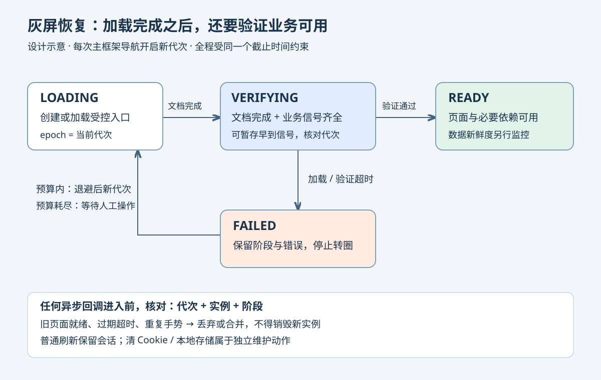

一台用于设备看板的 Android 平板，页面已经打开，随后突然只剩灰色背景。操作人员下拉刷新，界面持续显示“刷新中”，重启设备后才重新进入。这个现象很容易被解释为网络断开，也很容易催生一个看似直接的补丁：定时重载网页，失败就清缓存，再失败就重建 WebView。

问题在于，这些动作本身也会打断页面初始化。假如恢复判据只看 HTML 加载结束，系统可能一边宣称恢复成功，一边继续显示空页面；假如超时后反复销毁实例，尚未结束的旧回调又可能干扰新实例。本文研究的是这两类恢复机制缺陷，不把灰屏直接归因于某一种硬件或某个前端异常。

已有现象只能确认页面不可用、普通刷新未恢复、重启后曾恢复。还没有足够的前端异常日志、渲染进程退出记录和同条件复测，不能断言根因已经定位。下面的设计是可实施的排查与改进方案，不是生产修复成功报告。



## 一、先把“灰屏”拆成能取证的故障

灰色只是最终像素，可能是原生容器背景、前端空根节点，也可能是一个没有退出的遮罩层。网页入口返回成功，仍可能遇到脚本资源缺失、初始化异常、接口鉴权失败、渲染进程退出或视频组件阻塞。应先检查原生刷新提示究竟覆盖在哪一层，再比较 DOM 中是否存在业务节点。

在可调试构建中，通过 WebView 远程调试检查控制台和 Network；正式环境只保留必要诊断事件，不打开面向任意连接的调试入口。每次事件记录应用版本、WebView 提供程序版本、页面构建标识、单调时钟、恢复代次和阶段。资源路径以预先定义的类别记录，去掉查询参数、令牌和业务内容。

| 观察 | 优先补充的证据 | 还不能下的结论 |
| --- | --- | --- |
| 主文档返回 200，业务节点为空 | 脚本请求状态、首个 JS 异常、挂载事件 | 后端一定正常 |
| 页面节点存在，只有遮罩不消失 | 遮罩所有者、退出条件、业务状态 | 渲染进程已经崩溃 |
| 有渲染进程退出回调 | 退出原因、受影响实例、系统内存记录 | 灰屏全由内存不足造成 |
| 原生探测成功，页面接口失败 | 两条请求的协议、鉴权与实际目标差异 | 页面也已经联网 |

HTTP 探测只说明探测请求成功。它可能没有页面的 Cookie、代理条件或接口权限，不能代替业务请求验证。反过来，业务接口失败也不应直接触发设备断电重启：设备网络、页面会话与前端状态有各自的处理边界。

## 二、加载完成为何不够

Android 的 `onPageFinished` 是主框架加载阶段的通知，不承诺业务组件完成挂载。`onPageCommitVisible` 更接近新导航内容开始替换旧内容的显示边界，仍然不能证明业务接口和订阅已经可用。这两个信号都应作为诊断里程碑，而不是把异常计数清零的唯一条件。

实际产品需要定义自己的业务就绪合同。例如一个只读看板，可以要求核心根节点挂载、必要配置校验通过，并成功获得第一份结构有效的数据；如果实时源没有事件，应由独立心跳证明订阅仍存活，不能要求现场必须出现新告警才能就绪。

建议分开维护三个状态：页面能运行、业务依赖可用、数据是否新鲜。数据源断开时页面仍可以正常工作，明确显示离线状态与最后有效数据；这种情形不应被健康检查当成灰屏而无限重建。页面能响应探针，也不代表每个视频通道都在出帧，视频故障应留在对应组件处理。

前端就绪信号也不能只是扫描页面里有没有“刷新中”三个字。提示语会改变，隐藏节点也可能保留文字；更稳妥的是由实际初始化流程设置一个明确的状态对象，失败时留下阶段与错误类别。

## 三、恢复代次：让旧回调无法复活

下拉、定时器、网络变化和渲染退出都可能进入同一个恢复入口。仅用一个布尔变量禁止并发还不够：旧任务已经发出的网络请求无法被简单撤销，它可能在下一轮恢复中才返回。

每轮恢复应分配一个递增代次。所有异步完成、超时和前端信号都带上代次；处理时核对当前代次、当前实例以及预期阶段。开始新导航或销毁 Activity 时使旧代次失效，取消定时任务，并清理旧监听。重复手势可以合并成一个待处理请求，不能不断推迟当前超时期限。

下面是 **Python 3.8+ 可运行的状态逻辑示例**，只验证代次与就绪判据，不调用 Android API。`deadline` 是示例中的单调时钟值，实际应用应使用 `SystemClock.elapsedRealtime()`，并由主线程调度 WebView 操作。运行时不需要第三方依赖，也不需要提供真实设备地址。

```python
class RecoveryGate:
    def __init__(self):
        self.epoch = 0
        self.phase = "IDLE"
        self.deadline = 0.0

    def begin(self, now, budget):
        if budget <= 0:
            raise ValueError("budget must be positive")
        self.epoch += 1
        self.phase = "LOADING"
        self.deadline = now + budget
        return self.epoch

    def event(self, epoch, kind, now):
        if epoch != self.epoch or self.phase not in ("LOADING", "VERIFYING"):
            return False
        if now >= self.deadline:
            self.phase = "FAILED"
            return False
        if kind == "document_loaded" and self.phase == "LOADING":
            self.phase = "VERIFYING"
        elif kind == "business_ready" and self.phase == "VERIFYING":
            self.phase = "READY"
            return True
        return False

    def tick(self, now):
        if self.phase in ("LOADING", "VERIFYING") and now >= self.deadline:
            self.phase = "FAILED"


gate = RecoveryGate()
a = gate.begin(0, 20)
b = gate.begin(1, 20)
assert not gate.event(a, "business_ready", 2)  # 旧轮次无效
assert not gate.event(b, "document_loaded", 3)
assert gate.phase == "VERIFYING"
assert gate.event(b, "business_ready", 4)
assert not gate.event(b, "business_ready", 5)  # 重复信号无效
```

这里的二十秒只是验证状态逻辑的任意输入，不是推荐现场超时。真实超时应由慢启动、冷缓存和断网试验确定，并设置总预算。若前端信号比主文档回调更早到达，适配层应暂存当前代次的就绪证据，等两个条件齐全再转移状态；不能因为回调顺序不同就永久卡在 VERIFYING。

同一代次内若允许再次导航，还需要额外的导航标识；更简单的约束是每次主框架导航都开始新代次。这个示例没有实现线程同步、重试计数或 Android 实例清理，不能原样当作移动端完整恢复模块。

## 四、刷新、重建和清数据分别解决什么

普通手势首先应该尝试非破坏性操作：恢复数据订阅，或在确认主文档需要重载时加载受控入口。必须区分保留当前导航的 `reload()` 与回到配置入口的 `loadUrl()`；错误页、重定向和单页路由存在时，两者目的不同。入口来自应用配置并经过协议与来源校验，不能从错误页字符串中随意拼出地址。

只有实例不可继续使用、或有明确渲染故障证据时，再考虑重建。Android API 26 起提供 `onRenderProcessGone`；受影响的旧 WebView 需要从视图树移除并清理引用，不能继续复用。API 29 的 `WebViewRenderProcess.terminate()` 可能影响共享渲染进程的多个 WebView，返回值也不意味着退出清理已经完成。因而不能把“主动终止进程、等待一个固定短延迟、立即新建”当作普遍可靠的刷新语义。

这里优先选择不主动杀渲染进程的恢复路径。若产品确实需要主动终止，应统一管理所有受影响实例，以退出回调及代次保护协调清理，并单独验证没有回调、终止返回失败和 Activity 已销毁等分支。

清 HTTP 缓存、移除 Cookie 与删除网页本地存储是不同动作。缓存影响资源获取；Cookie 可能承载登录会话；本地存储可能有草稿、偏好和待同步记录。连续下拉不应隐式升级成清除全部数据。深度重置应成为明确的维护操作，提示影响、记录原因，再由产品规定如何重新认证。

定时整页刷新也不适合作为长期默认健康策略。它会重建 JS 上下文，关闭长连接、视频与定时任务，恰好可能打断正在完成的初始化。优先刷新数据；只有页面版本切换或受控故障恢复需要时才整页导航。缓存版本不匹配要修入口与资源发布一致性，不能只增加刷新频率。

## 五、怎样证明恢复机制比原来可靠

排查应保留一个不执行自动恢复的对照构建，用于看到首个错误；另一个构建启用分级恢复，比较从故障到业务可用的阶段，而不是只比较是否闪过页面。测试环境可以分别制造脚本资源失败、业务接口超时、失效会话、旧回调晚到和连续手势，确认每一种情况都进入预期阶段。

最关键的反例是：主文档正常，但业务初始化始终失败。此时应保留明确错误提示，耗尽预算后停止自动重建，允许人工重新尝试；不能把“加载完成”当成成功，下一秒又自动重试。另一个反例是页面已经 READY，但一个过期计时器随后触发销毁；代次与阶段校验必须同时挡住它。

观察恢复后是否只有一个有效订阅、一个活动 WebView 和一组当前计时器。失败计数应在稳定可用一段观察窗口后清零，避免偶然收到一个就绪信号就重置整个重试预算。长时间后台或设备休眠时，探针要暂停或重新校准，不要把系统暂停执行 JS 误判成页面永久失效。

业务就绪对象只暴露状态，不暴露用户、令牌或业务数据。若通过原生 JS 桥接收消息，还必须限制可信页面与导航，避免给不可信 iframe 提供原生能力；只做健康检测时可以优先由原生在受控页面执行只读状态查询。

## 六、结论：恢复要有可验证的终点

灰屏的根因需要渲染、资源与业务初始化证据共同定位，重启后恢复不能反推根因。当前能够确定的设计原则是：加载回调不能单独证明业务可用，恢复动作必须有代次隔离与总预算，清会话数据也不能伪装成普通刷新。

与[页面生命周期导致实时连接断开](/tech/2024/07/31/android-webview-websocket-reconnect/)相比，这里增加的是页面恢复的完成合同和并发约束；与[USB 网卡枚举排障](/tech/2026/11/03/android-usb-ethernet-poe-reenumeration/)相比，本文处理的是网络可达之后仍可能存在的应用层失败。三者需要关联取证，但不能共用一个“在线”布尔值。

## 参考资料

- [Android WebViewClient：页面回调及渲染进程退出](https://developer.android.com/reference/android/webkit/WebViewClient)：本文使用的 onPageFinished、onPageCommitVisible、onRenderProcessGone 分别始于 API 1、23、26。
- [Android WebViewRenderProcess：terminate 与共享进程影响](https://developer.android.com/reference/android/webkit/WebViewRenderProcess)：API 29 起提供，使用时需处理所有受影响 WebView。
- [Android WebView：加载、缓存与销毁 API](https://developer.android.com/reference/android/webkit/WebView)：用于核对各操作边界；本文不依赖较新系统才提供的新增接口。
